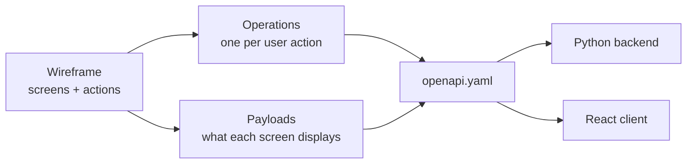

# 3. API design: a UI-driven BFF

Chapter 2 explained *how* to write an operation. This chapter explains *which* operations
to write, and why the project's API looks the way it does.

## Two ways to design an API

| Approach | Starting point | The API mirrors | Good for |
|---|---|---|---|
| **Domain-driven** (resource-oriented) | the domain model | entities and their relations | public APIs, many different clients |
| **UI-driven** (Backend for Frontend) | the screens of one client | what each screen shows and does | one known client, fast iteration |

The project contains both:

- [`openapi.domain.yaml`](../openapi.domain.yaml) was derived from the domain model. It is a
  school exercise and is **not implemented**.
- [`openapi.yaml`](../openapi.yaml) was derived from the UI wireframe. It is the contract
  that the Python backend implements and the React client uses.

## What a BFF is

A **Backend for Frontend (BFF)** is an API shaped around the needs of **one specific
frontend**. Instead of a generic API that every client must adapt to, the backend offers
exactly the operations and the data that the user interface needs, in the form that is
easiest for it to use.



## From the wireframe to the contract

The wireframe [`doc/ui.excalidraw`](../../doc/ui.excalidraw) draws every screen of the
application. Next to each screen it notes the **client route** (the page URL) and the
**API calls** the screen needs. The contract was written from these notes.

| Screen in the wireframe | Client route | User actions | Operations in `openapi.yaml` |
|---|---|---|---|
| Manage test suites | `/test-suites` | see all suites and their test counts; delete a suite | `GET /api/test-suites` (`listTestSuites`), `DELETE /api/test-suites/{suite-id}` (`deleteTestSuite`) |
| Edit test suite | `/test-suites/{suite-id}` | create or rename a suite; see its tests; delete a test | `POST /api/test-suites`, `PUT /api/test-suites/{suite-id}`, `GET /api/test-suites/{suite-id}/test-cases`, `DELETE /api/test-cases/{case-id}` |
| Edit test case | `/test-cases/{case-id}` | create or edit a test with its variables and expectations; add or edit an expectation | `POST /api/test-cases`, `GET`/`PUT /api/test-cases/{case-id}`, `GET /api/test-cases/{case-id}/expectations`, `POST /api/expectations`, `PUT /api/expectations/{expectation-id}` |
| Run and view all reports | `/execute/{suite-id}` | see the past runs of a suite | `GET /api/test-suites/{suite-id}/eval-runs` (`listSuiteEvalRuns`) |
| Select model provider | `/execute/{suite-id}/run` | choose provider and model, start a run | `POST /api/test-suites/{suite-id}/eval-runs` (`createEvalRun`) |
| View a single report | `/reports/{eval-run-id}` | read every result, score and failure | `GET /api/eval-runs/{eval-run-id}` (`getEvalRun`) |

The **tags** follow the three sections of the navigation bar drawn on every screen,
*Define | Execute | Report*: `Test Creation`, `Execution`, `Reporting`.

Notice that client routes and API paths are parallel: the page `/test-cases/{case-id}`
calls `/api/test-cases/{case-id}`, and the page `/reports/{eval-run-id}` calls
`/api/eval-runs/{eval-run-id}`. A test case is addressed by its own ID, without the suite
ID, because the "Edit test case" page receives only that ID.

## BFF traits in the contract

### 1. Aggregated responses: one call fills a screen

`GET /api/test-suites` returns every suite **with its tests and their expectations**
(`TestSuite.tests` → `TestCase.expectations`). The "Manage test suites" screen shows
"10 tests" for each suite without one extra call per suite. The React client goes further:
it loads this tree once ([`App.tsx`](../../web-client/src/App.tsx), `listTestSuites`) and
the suite and test pages read from it.

Likewise `GET /api/test-suites/{suite-id}/eval-runs` returns complete runs with all
results, so the "Run and view all reports" screen can compute "3/5 passed" for each run.

### 2. Operations follow forms, not tables

The "Edit test case" screen has **one form** with title, prompt, variables and
expectations, and one *Save* button. So the contract creates and replaces a test together
with its expectations in a single call:

```yaml
CreateTestCaseInput:
  required: [suite_id, title, prompt, expectations]   # expectations included
```

A domain-driven API would more likely create the test first and then each expectation.

### 3. Server-computed values the UI just displays

`EvalResult.passed` is `readOnly`: the server computes it with the domain rule, and the UI
only shows it. Business rules stay in the backend; the client does not reimplement them.

### 4. Inputs separated from outputs

Forms send `…Input` schemas without IDs; screens receive the full objects with IDs
(chapter 2). Each schema matches exactly what one side needs.

## Comparison with the domain-driven contract

| Aspect | `openapi.yaml` (UI-driven, implemented) | `openapi.domain.yaml` (domain-driven, exercise) |
|---|---|---|
| Origin | screens of the wireframe | subsystems of the domain design |
| Tests | flat: `/api/test-cases/{case-id}` | nested: `/api/test-suites/{suiteId}/tests/{testId}` |
| Saving a test | test and expectations in one call | test inputs and expectations handled separately |
| Single suite | no `GET` (the client reuses the loaded list) | `GET /api/test-suites/{suiteId}` |
| Invalid input | 422 (FastAPI's convention) | 400 |
| Extra subsystems | — | reports and JSON export |
| Health check | `/health` | absent |

Neither is "wrong": each optimises for a different reader.

## Trade-offs of a BFF

| Advantage | Risk | How the project handles it |
|---|---|---|
| Few calls, simple client code | Responses grow as the UI grows (the full tree on every list) | Acceptable for an MVP with small suites |
| Contract easy to explain from the screens | Coupling: a UI change may require a contract change | One client, one team, contract-first workflow |
| Business rules stay on the server | A second, different client may need different endpoints | Add a second BFF, or a generic API, when it appears |
| Operations named after user actions | Endpoints may be unused if the UI changes | Review the contract when the wireframe changes |

The last risk is visible today: the contract still contains operations that the current
client does not call (`listSuiteTestCases`, `getTestCase`, `listTestCaseExpectations`,
`updateExpectation`), because the client now reads tests and expectations from the loaded
suite tree. Conversely, the wireframe annotates `GET /api/test-suites/[test-suite-id]`,
which the contract does not define. Keeping UI, contract and code aligned is ongoing work.

## Designing a new feature, step by step

1. **Draw** the screen, or the change to a screen, in the wireframe.
2. **Annotate** the user actions and the data the screen needs.
3. **Write** the operations in `openapi.yaml`: path, method, `operationId`, tag, input and
   output schemas, status codes. Reuse existing schemas and conventions.
4. **Validate** the document and **regenerate** the code (chapter 4).
5. **Implement** the backend route and use the generated client in the UI.
6. **Test** the workflow end to end.

---

← [2. Describing an API](02-describing-apis.md) · Next: [4. Generating code from the contract →](04-code-generation.md)
