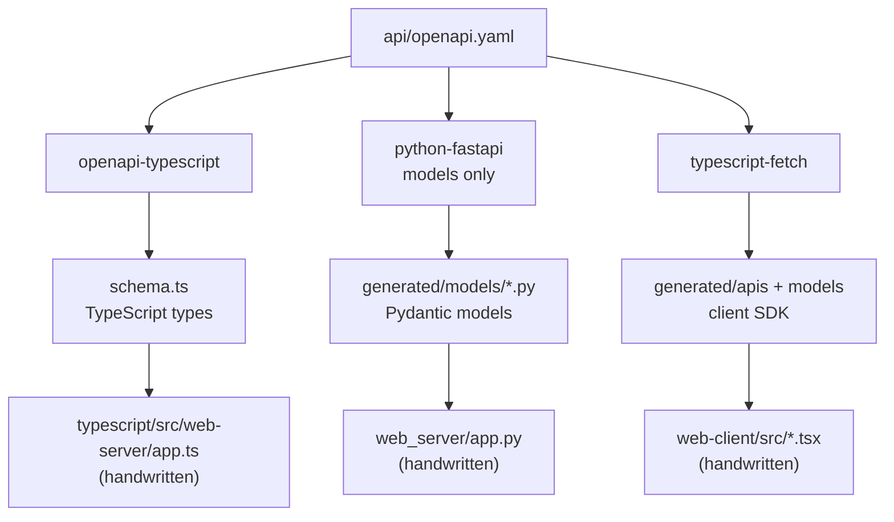
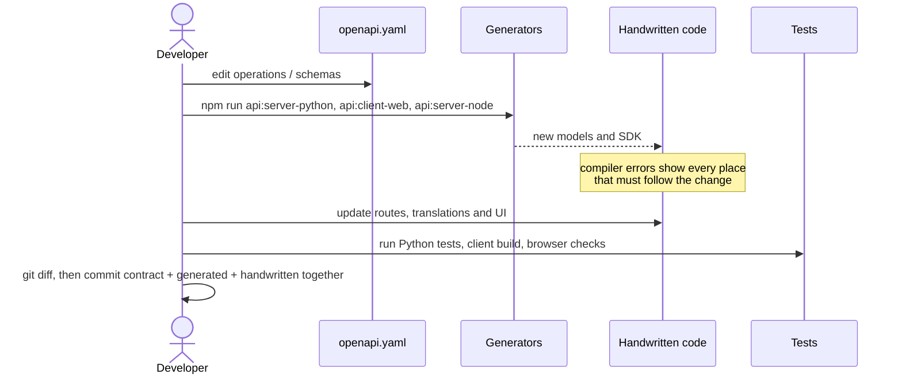

# 4. Generating code from the contract

An OpenAPI document is machine-readable, so tools can write the repetitive code that
sends, receives and checks HTTP messages. This chapter explains what can be generated,
what this project generates, and how generated and handwritten code fit together.

## What can be generated

| Kind | Side | Contains | Generated in this project? |
|---|---|---|---|
| **Types / models** | both | one class or type per schema | yes: TypeScript server types, Python models, client models |
| **Server stub** | server | routes or controller skeletons with empty methods to fill in | no, on purpose |
| **Client SDK** | client | one class per tag, one method per operation, request and response handling | yes: the React client |
| **Documentation** | readers | HTML pages | no (FastAPI serves `/docs`) |

A **server stub** is a skeleton: the generator writes the routing, and the developer fills
in the method bodies. The project does **not** generate stubs: routes are handwritten in
[`app.py`](../../python/src/smartest_ai_testbook/web_server/app.py), so they stay small
and readable, and the generator never overwrites them. Only the data types are generated.

## The three generators

All commands run from the repository root after `npm ci` (Java 21 is needed by OpenAPI
Generator). Versions are pinned in `package.json` and `openapitools.json`.

| Command | Tool | Output | Used by |
|---|---|---|---|
| `npm run api:server-node` | `openapi-typescript` | `typescript/src/web-server/generated/schema.ts` | TypeScript server |
| `npm run api:server-python` | OpenAPI Generator, `python-fastapi` | `python/src/smartest_ai_testbook/web_server/generated/models/` | Python server |
| `npm run api:client-web` | OpenAPI Generator, `typescript-fetch` | `web-client/src/generated/` | React client |



### 1. TypeScript server: types only

`openapi-typescript` writes one file of type declarations. The handwritten Express server
uses them to type its response:

```ts
// typescript/src/web-server/app.ts
import type { components } from './generated/schema.js';

app.get('/health', (_request, response) => {
  const health: components['schemas']['HealthResponse'] = { status: 'ok' };
  response.json(health);
});
```

Types are checked at compile time only: they do not validate data at run time.

### 2. Python server: Pydantic models

The `python-fastapi` generator is restricted to models
(`--global-property models,modelTests=false,modelDocs=false`). Each schema becomes a
Pydantic class that **validates at run time**:

```python
# generated from components/schemas/TestSuiteInput
class TestSuiteInput(BaseModel):
    name: Annotated[str, Field(min_length=1, strict=True)]   # from required + minLength: 1
    description: Optional[StrictStr] = None                  # optional property
```

The handwritten route declares the model as its body type, and FastAPI validates every
request against it ([Python Appendix A](../../python/doc/07-fastapi.md)):

```python
@app.post("/api/test-suites", status_code=201)
def create_suite(data: TestSuiteInput): ...
```

### 3. React client: a complete SDK

`typescript-fetch` generates API classes, models and a small runtime. The client creates
one object per tag and calls methods named after the operations:

```ts
// web-client/src/App.tsx
const config = new Configuration({ basePath: apiBaseUrl });
const api = { tests: new TestCreationApi(config), execution: new ExecutionApi(config), ... };

// web-client/src/RunPage.tsx
const run = await api.execution.createEvalRun({ suiteId, evalRunInput: { providerName: provider, modelName: model } });
```

The client code never writes a URL, a method or `JSON.stringify`: the SDK does it, and the
TypeScript compiler checks every field name.

## How contract names become code names

| In `openapi.yaml` | In the React client | In the Python server |
|---|---|---|
| tag `Execution` | class `ExecutionApi` (+ interface `ExecutionApiInterface`) | — (routes are handwritten) |
| `operationId: createEvalRun` | method `createEvalRun(...)` | — |
| path parameter `suite-id` | request field `suiteId` | route argument `suite_id: UUID` |
| request body `EvalRunInput` | request field `evalRunInput` | argument `data: EvalRunInput` |
| schema `EvalRun` | interface `EvalRun` + `EvalRunFromJSON` / `EvalRunToJSON` | dict built by `run_json` |
| property `provider_name` | property `providerName` (converted automatically) | attribute `provider_name` |
| `enum` | a const object and the union of its values (`ExpectationInputEvaluatorTypeEnum`) | validated string |
| `nullable: true` | `string \| null` | `Optional[str]` |

The client converts snake_case JSON to camelCase TypeScript and back, so each language
keeps its own naming style while the wire format stays the same.

## Rules for working with generated code

1. **Never edit generated files.** Change `openapi.yaml` and regenerate. Every generated
   file starts with a "Do not edit" notice.
2. **Commit the generated code.** Builds do not need Java, and reviews show the effect of
   a contract change.
3. **Review with `git diff`** after regenerating. An unexpected difference means the
   contract changed or someone edited a generated file.
4. **Keep handwritten code out of `generated/`.** The Python and client commands first
   delete their output folder (npm `pre` scripts), because the generator does not remove
   files of deleted schemas.
5. **Customise through options and templates, not edits.** The project needs every
   TypeScript class to implement an interface, so `withInterfaces=true` is set, and
   [`api/templates/typescript-fetch/runtime.mustache`](../templates/typescript-fetch/runtime.mustache)
   is a copy of the generator's runtime template with interfaces added. When the
   generator is upgraded, compare it with the new upstream template.

## The workflow of a contract change



Generated code makes contract changes **visible**: a renamed field breaks the TypeScript
build in exactly the places that use it, instead of failing silently in the browser.

## What generation does not do

- It does not write business logic: routes, domain classes and UI stay handwritten.
- It does not enforce rules that the schema cannot express (chapter 2): the domain does.
- It does not prove that a server implements the contract: tests do. The TypeScript server
  has the generated types of every schema, but implements only `/health`.

For versions, options and troubleshooting, see the reference page
[doc/api-generation.md](../../doc/api-generation.md).

---

← [3. API design: a UI-driven BFF](03-api-design-bff.md) · [Back to the lesson plan](README.md)
