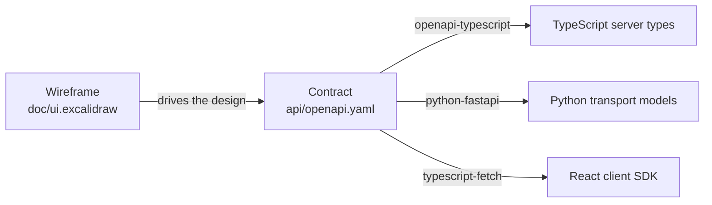

# The HTTP contract — a lesson on OpenAPI

This folder explains how the HTTP API of *SMARTest AI Testbook* is described, designed
and turned into code. It is written for students who know what an HTTP request is, but
have never written an OpenAPI document.

Everything starts from one file, [`api/openapi.yaml`](../openapi.yaml): the **contract**
between the React client and the backends. From it, tools generate the code that both
sides use to exchange data.

## Lesson plan

| # | Chapter | What you will learn |
|---|---|---|
| 1 | [The OpenAPI standard](01-openapi-standard.md) | What OpenAPI is, why a contract is useful, the structure of a document. |
| 2 | [Describing an API](02-describing-apis.md) | Paths, operations, parameters, bodies, responses and schemas, with the project's conventions. |
| 3 | [API design: a UI-driven BFF](03-api-design-bff.md) | How the wireframe shaped the endpoints, what a Backend for Frontend is, and its trade-offs. |
| 4 | [Generating code from the contract](04-code-generation.md) | Stubs, models and client SDKs; the three generators of the project and how handwritten code uses them. |

Read the chapters in order. Review questions and exercises are at the end of this page.

## Files in `api/`

| File | Role |
|---|---|
| [`openapi.yaml`](../openapi.yaml) | **The** contract implemented by the Python backend and used by the client. |
| [`openapi.domain.yaml`](../openapi.domain.yaml) | A school exercise: an alternative contract derived from the domain model, not implemented. Chapter 3 compares the two. |
| [`templates/typescript-fetch/`](../templates/typescript-fetch/) | A customised generator template for the client runtime (chapter 4). |
| [`scripts/`](../scripts/) | Shared HTTP and browser checks run against both backends. |

## Related documents

- [UI wireframe](../../doc/ui.excalidraw): the screens and the API calls annotated on each one (open it with [Excalidraw](https://excalidraw.com/) or the VS Code extension).
- [API generation](../../doc/api-generation.md): generator versions, commands and safe regeneration (reference).
- [Web architecture](../../doc/web-architecture.md): servers, client and configuration.
- [Python lesson](../../python/doc/README.md): how the Python backend implements the contract, including [Appendix A on FastAPI](../../python/doc/07-fastapi.md).

## Review questions

1. What is the difference between the contract and the implementation of an API?
2. What do `paths` and `components` contain in an OpenAPI document?
3. Why does the project have both `TestCaseInput` and `TestCase` schemas?
4. Which screen of the wireframe uses `POST /api/test-suites/{suite-id}/eval-runs`?
5. Why does `GET /api/test-suites` return suites *with* their tests and expectations?
6. What does "Backend for Frontend" mean, and what is its main risk?
7. What is the difference between a server stub, transport models and a client SDK? Which ones does the project generate?
8. How does the operation `createEvalRun` with tag `Execution` become code in the React client?
9. Why must generated files never be edited by hand?

## Exercises

1. **Read a screen.** Open the wireframe, pick the "Edit test case" screen and list the
   operations of `openapi.yaml` it needs. For each one write method, path, request schema
   and possible status codes.
2. **Spot the difference.** The wireframe annotates `GET /api/test-suites/[test-suite-id]`
   on the "Edit test suite" screen, but `openapi.yaml` has no such operation. Find in
   `web-client/src/` how the client gets a single suite, and discuss whether the operation
   should be added.
3. **Design an endpoint.** The domain requires a JSON export of a suite with its run
   history. Sketch the screen element that triggers it, then write the OpenAPI operation
   (path, method, `operationId`, tag, responses). Compare your result with the export
   operation in `openapi.domain.yaml`.
4. **Follow the generation.** Add a `description` to `EvalRunInput.provider_name` in
   `openapi.yaml`, run `npm run api:client-web` and inspect with `git diff` where the text
   appears in the generated client. Then discard both changes with `git restore`.
