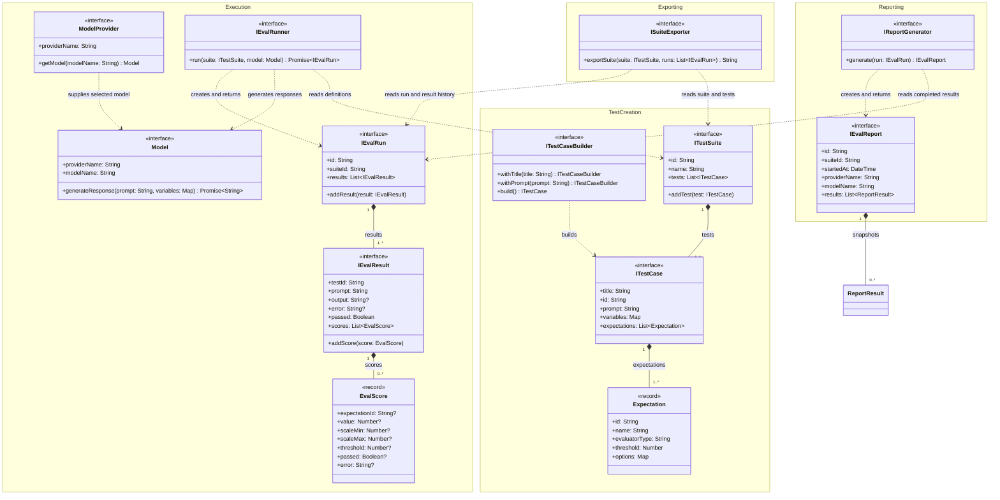
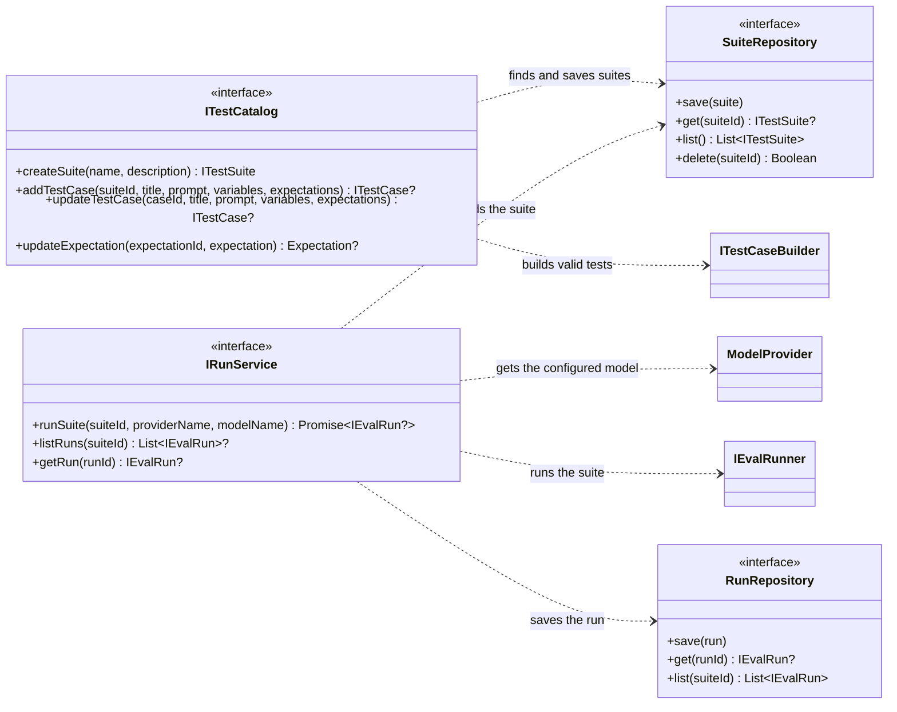
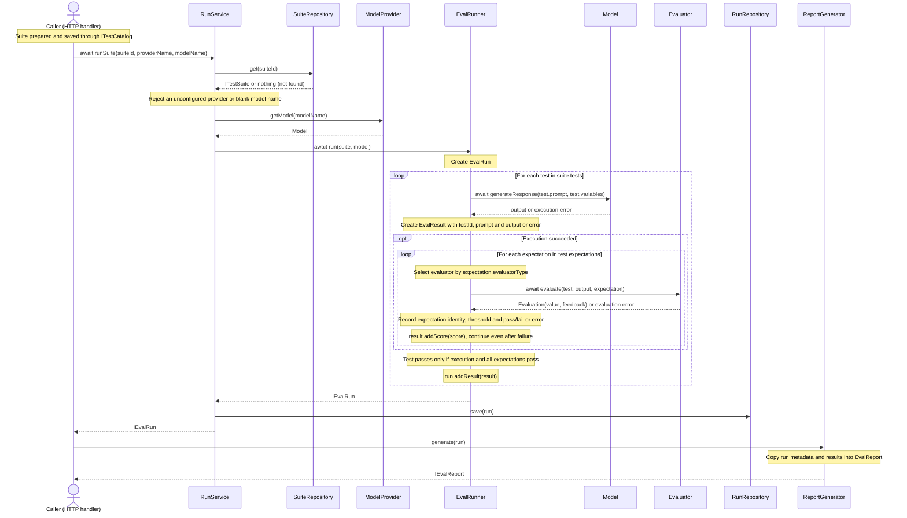
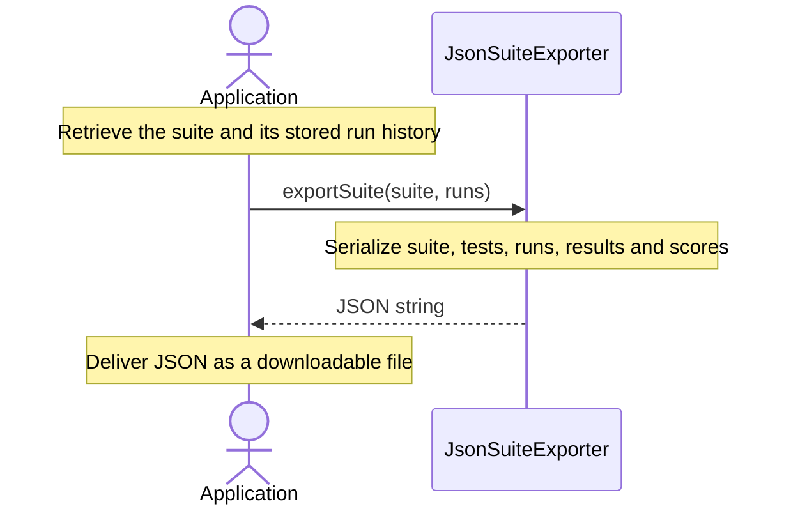
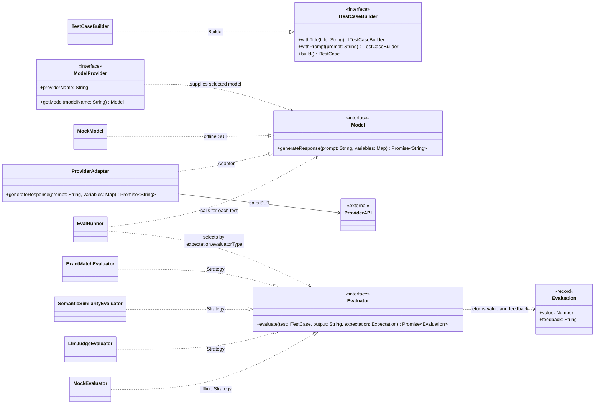

# Minimal Class Diagram — MVP

The domain has four logical subsystems: **test creation → execution → reporting**, plus independent **exporting**.
They communicate through public contracts in the same application. In the Python implementation, one **application service** per persisted subsystem owns its use cases and saves through injected repositories (see [Application services](#application-services)).
Only essential fields and operations are shown. The [requirements](./requirements.md) remain the reference.

## 1. Subsystems and public contracts

| Subsystem | Public entry points | Output |
|---|---|---|
| Test creation | `ITestCaseBuilder`, `ITestSuite` | A configured `ITestSuite`. |
| Execution | `IEvalRunner.run(suite, model)` | A completed `IEvalRun`, including results and scores. |
| Reporting | `IReportGenerator.generate(run)` | An `IEvalReport` exposing the recorded results. |
| Exporting | `ISuiteExporter.exportSuite(suite, runs)` | A JSON string containing the suite, tests and run/result history. |

The diagram shows public contracts rather than duplicating every interface and its implementation. Namespaces represent logical subsystems, not deployment units or required directory layers. Arrows show structural dependencies; the sequence below shows execution order.



Concrete domain classes explicitly implement these contracts:

| Public contract | Implementation |
|---|---|
| `ITestCaseBuilder` | `TestCaseBuilder` |
| `ITestSuite` | `TestSuite` |
| `ITestCase` | `TestCase` |
| `IEvalRunner` | `EvalRunner` |
| `IEvalRun` | `EvalRun` |
| `IEvalResult` | `EvalResult` |
| `IReportGenerator` | `ReportGenerator` |
| `IEvalReport` | `EvalReport` |
| `ISuiteExporter` | `JsonSuiteExporter` |

### Responsibilities and dependency direction

- **Test creation:** the builder validates a test and assigns its UUID; `suite.addTest(test)` assembles the suite. `TestCase` defines the input and contains expectations, each with its own criteria; it has no `run` method. This subsystem knows no providers, runners or reports.
- **Execution:** `EvalRunner` coordinates the suite. The application obtains a `Model` through `ModelProvider.getModel(modelName)` and passes it to `run(suite, model)`. For each test the runner awaits the model response, creates an `EvalResult`, awaits every configured evaluator on a successful output, adds the returned scores and stores the result in `EvalRun`. It returns the completed run and knows no report classes. `EvalRun` records execution data and provides `addResult`; it does not execute tests.
- **Reporting:** `ReportGenerator` creates an `EvalReport` from the completed run. The report exposes the recorded results without aggregation. This subsystem knows no runner, builder or provider implementations.
- **Exporting:** `JsonSuiteExporter` reads `ITestSuite` and its related `IEvalRun` objects and returns JSON containing the suite, tests, expectations, runs, results and scores. The caller retrieves the suite and its complete stored run history, which may be empty, and supplies them to `exportSuite`. Exporting is independent of execution and report generation and has no dependency on `EvalRunner` or `ReportGenerator`. The web interface handles downloading the returned JSON.

### Application services

Entities never save themselves. Each use case of the web workflow is an operation of an **application service**, which finds the domain objects through repositories, changes them through the domain contracts (builder, suite, runner) and saves the result. Services receive all their collaborators by dependency injection from the composition root.



| Service | Implementation | Use cases | Rules it owns |
|---|---|---|---|
| `ITestCatalog` | `TestCatalog` | list, create, update and delete suites; list, add, read, update and delete test cases; list, add and update expectations | locating tests and expectations across suites; an updated test may keep, change or drop its expectations but not reuse IDs of other tests or repeat them; changing an expectation rebuilds and revalidates its test |
| `IRunService` | `RunService` | start a run, list the runs of a suite, read a run | only the configured provider and a nonblank model name are accepted; a completed run is saved |

The diagram shows only some `ITestCatalog` operations. Outcomes use no extra classes: an operation returns nothing (or `false` for a delete) when the requested item does not exist, and raises the domain's validation error for invalid input. The HTTP server translates these outcomes into status codes; any other caller can use the services directly.

Repository contracts belong to the domain; their SQLite implementations belong to persistence. Reporting and exporting have no service because they read completed data and save nothing.

### AI integration points

An AI service is involved at exactly two points:

1. **System under test (SUT):** during a run, the runner calls the selected `Model` once per test to generate the response.
2. **AI evaluation service:** only `semanticSimilarity` (embeddings) and `llmJudge` (a judge model) call an AI service while evaluating an expectation. `exactMatch` is a literal comparison and never needs one.

Both points are reached only through domain contracts (`ModelProvider`/`Model` and `Evaluator`), so the application chooses their implementations at startup. Besides the OpenAI adapters, both languages provide deterministic offline mocks for validating the flow without real models:

| Point | Contract | Real implementation | Mock implementation |
|---|---|---|---|
| SUT | `ModelProvider`, `Model` | `OpenAIProvider`, `OpenAIModel` | `MockProvider` (`providerName` `mock`), `MockModel`: answers `[mock] ` followed by the prompt with its variables filled in |
| AI evaluation | `Evaluator` | `SemanticSimilarityEvaluator`, `LlmJudgeEvaluator` | `MockEvaluator`: validates the expectation, then returns value 1 and feedback `Mock evaluation` |

In mock mode both points are replaced together; `exactMatch` keeps its real behavior, so it normally fails on mock answers while the AI expectations pass. Mocks check the flow, not the quality of the results.

The application supplies available evaluators to the runner, keyed by evaluator type. An `Expectation` describes a configured check; an `Evaluator` is the algorithm that performs it. The runner selects that algorithm through the `evaluatorType` property. An expectation neither creates nor depends on evaluator implementations. Multiple expectations may use the same evaluator type with different parameters.

Each run also records its start time and provider/model names. It links to the suite through `suiteId`, and each result retains `testId`; neither requires a reference to the live suite or test object. Errors stay in their test's result and do not stop the following tests. A failed execution has no output to evaluate, so it may have no scores.

Each result records the prompt template used at execution time. The report copies run metadata, results and scores into an independent snapshot. It does not retain test versions or all test definition fields.

### Test inputs and expectations

`ITestCase` contains only ID, title, prompt, variables and expectations. The title and prompt must not be blank. Variables supply values for placeholders in the prompt and default to an empty map. The selected model receives only the prompt and variables; its adapter handles variable substitution. Evaluation criteria belong to the expectations, so two checks of the same response can use different reference answers or rubrics.

The builder validates every expectation before creating a test. A reusable validation function checks supported evaluator types, nonblank names and criteria, finite 0–1 thresholds, and exactly the options required by each evaluator. Unsupported options are rejected. No additional configuration classes or factories are needed.

`Expectation` is a plain configuration record with these properties:

| Property | Meaning |
|---|---|
| `id` | Stable identifier linking this check to its recorded outcome. |
| `name` | Readable label shown in reports and exports. |
| `evaluatorType` | Key selecting the evaluator algorithm. |
| `threshold` | Required minimum score to pass on 0–1; fixed to 1 for exact match. |
| `options` | The required criteria for this check, in one of the forms below. |

| `evaluatorType` | Required `options` | Threshold |
|---|---|---|
| `exactMatch` | `{ "expected": "Paris" }` | Exactly 1; literal string equality returns 0 or 1. |
| `semanticSimilarity` | `{ "expected": "Paris" }` | A finite number from 0 to 1. |
| `llmJudge` | `{ "rubric": "The answer contains only the city name." }` | A finite number from 0 to 1. |

For example:

```json
{
  "id": "EXP-01",
  "name": "Similarity to the reference answer",
  "evaluatorType": "semanticSimilarity",
  "threshold": 0.85,
  "options": { "expected": "Paris" }
}
```

Each expectation is understandable on its own. Repeating a short reference string across two checks is acceptable and keeps their criteria independent. The interface exposes ordinary expected-answer or rubric fields according to the selected type, fixes the exact-match threshold to 1, and offers an editable threshold for the other types. Users do not edit JSON options. Embedding and judge model names are application configuration; the model under test is selected once per run.

### Recorded outcomes and pass/fail

`EvalScore` is also a plain record. The diagram shows a subset of its fields:

| Record | Fields |
|---|---|
| `EvalScore` | Expectation ID and name, evaluator type, value, scale minimum/maximum, applied threshold, pass/fail outcome, feedback and optional error. |

Evaluators return an `Evaluation` record containing a numeric `value` and `feedback`, without deciding pass/fail. All three strategies use the 0–1 scale. The runner rejects non-finite or out-of-range values as evaluation errors, records the expectation ID, name, evaluator type and applied threshold, and alone determines success using `value >= threshold`. Successful recorded scores retain scale bounds 0 and 1 for reports and stored history. An evaluation error produces a failed outcome with an error message and no numeric value or scale. The runner catches that error and continues with the remaining expectations.

A test passes only when execution succeeds and **all its expectations pass**. Every test has at least one expectation. `IEvalResult.passed` is derived from this rule, rather than set independently. A provider error fails the test and leaves its scores empty. A failed expectation never stops the remaining checks or tests.

Reports and JSON exports expose each test's pass/fail outcome and clearly identify every failed expectation by ID, name and evaluator type, with its score and threshold or error message. Recorded labels and thresholds remain available even if the test definition is later edited.

Each expectation outcome retains its own score. A shared 0–1 scale does not make different algorithms equivalent; the report does not average their values, calculate an overall score or aggregate results.

## 2. Application flows

### Execution and reporting

The caller, for example an HTTP handler, asks the run service to run a stored suite with a provider and model name. The service loads the suite, checks the provider, obtains the model, calls the runner and saves the completed run; reporting is called separately on that run. Tests and their expectations execute sequentially; each test generates exactly one response and every check evaluates that same response.



`EvalRunner` owns the two loops. Its public asynchronous `run` method iterates over tests and delegates each iteration to a private asynchronous `runTest` method. Evaluators receive the test definition, output and expectation, and return `Promise<Evaluation>`; they may use the prompt and variables as context but read criteria only from that expectation. They do not receive or modify an `EvalResult`. The runner awaits each evaluation, records the expectation metadata and applies the threshold rule. Rejected promises and invalid values are isolated per expectation. Reporting consumes the recorded results without calling the model or repeating individual evaluations. There are no configurable AND/OR policies, weights, concurrency or retries.

### Independent export

Export can be requested for an existing suite at any time, including before its first run. It does not require a new execution or report.



## 3. Required patterns



- **Builder:** create a valid test before adding it to the suite. Optional setters are omitted; a suite needs no builder of its own.
- **Adapter:** translate the external provider API into `Model`, supplied by `ModelProvider`. The selected model is the **SUT (System Under Test)**. A provider selects a model; it does not forward generation calls.
- **Strategy:** evaluator implementations vary the evaluation algorithm while the runner keeps the same loop. No factory or resolver class is needed.
- **Mocks:** `MockModel`/`MockProvider` and `MockEvaluator` are further implementations of the same contracts. They replace the SUT and the AI evaluation service without changing the runner.

## Implementation boundaries

Every TypeScript class and every Python domain class must explicitly implement the public contracts required by [AGENTS.md](../AGENTS.md). The table lists the core contracts; strategy and adapter contracts are shown in the pattern view, application services in their own section. Plain records are data types. Both languages implement this same model, except for the differences listed below.

TypeScript and Python implement the same test configuration, three evaluation strategies, mock SUT and mock evaluator, fixed execution policy and reporting responsibilities. Deterministic providers used by tests are test support. The Python application also provides SQLite persistence and the suite/test/run HTTP workflow; the TypeScript HTTP server currently provides only `GET /health`. Generated transport types do not imply HTTP endpoint parity. The application services (`TestCatalog`, `RunService`) and the repository contracts exist only in Python: by decision of the project owner they were not added to TypeScript, which has no persistence or HTTP workflow, so this is an accepted exception to the parity rule. See [web architecture](./web-architecture.md) for these supporting-code boundaries and verification scope.

The SQLite loader keeps existing definitions readable by copying legacy shared reference answers and rubrics into the corresponding expectation options when a local criterion is absent. Local options take precedence. Reads do not rewrite the database; the next normal save writes only the new definition shape. Existing run rows and report snapshots are preserved.

Database storage remains required for suites, tests, runs and results. The exporting subsystem owns JSON serialization through `ISuiteExporter`; HTTP delivery, file download, database details and accessors are outside this domain view.
