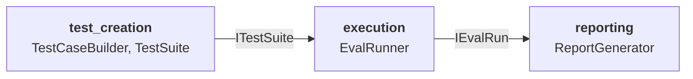
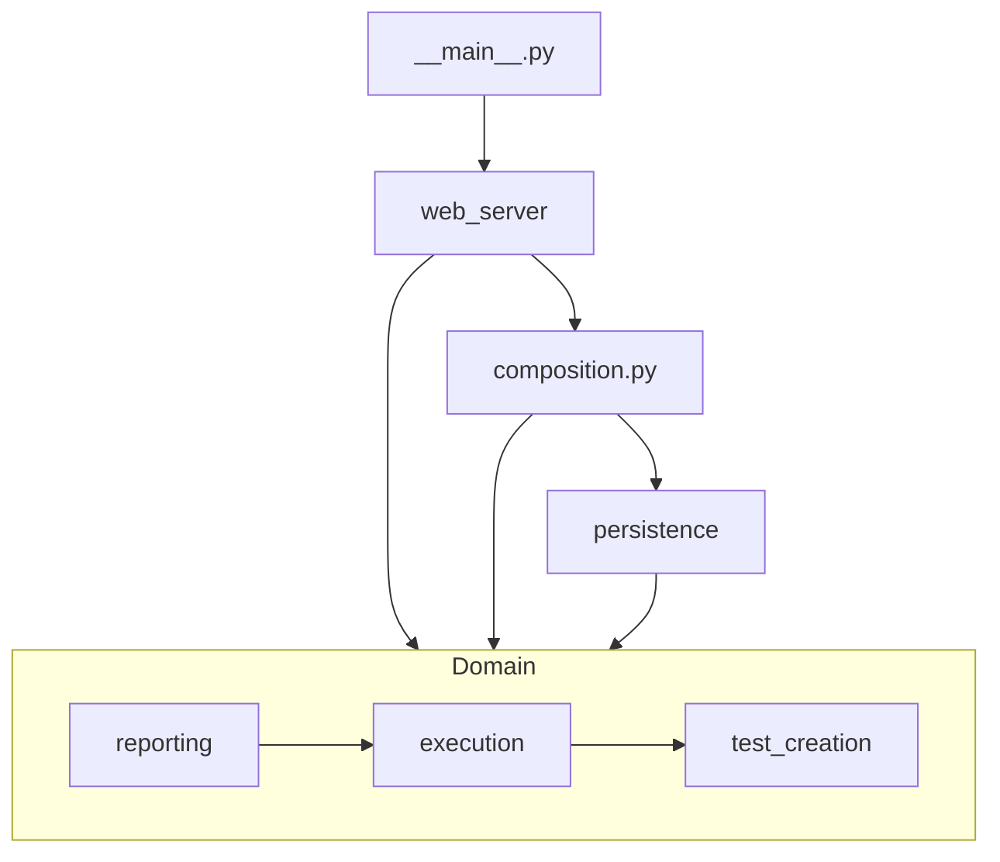

# 1. The big picture

## What the application does

SMARTest AI Testbook tests **AI language models**, in the same way unit tests check
ordinary code:

1. A user writes a **test suite**: a named group of **test cases**.
2. Each test case has a **prompt** (the question for the model) and one or more
   **expectations** (the checks the answer must pass, e.g. "the answer is exactly
   *Paris*").
3. The user **runs** the suite against a chosen model. For every test case the
   application asks the model, then **evaluates** the answer against each expectation.
4. The result is an **evaluation run**: for every test, the model output, a score for
   each expectation and whether the test passed.

Keep these words in mind; the [glossary](../../doc/glossary.md) defines all of them.

## The packages

All the code lives in [`src/smartest_ai_testbook/`](../src/smartest_ai_testbook/).
Each folder is a Python package with one clear responsibility:

```text
smartest_ai_testbook/
├── test_creation/      DOMAIN   Define suites, test cases and expectations
├── execution/          DOMAIN   Run a suite on a model and evaluate the answers
├── reporting/          DOMAIN   Turn a finished run into a report
├── persistence/        INFRASTRUCTURE  Save and load domain objects with SQLite
├── web_server/         INFRASTRUCTURE  Expose the application as an HTTP API (FastAPI)
│   └── generated/               Request/response models generated from the API contract
├── composition.py      WIRING   Create all objects and connect them
└── __main__.py         STARTUP  Start the web server
```

We can group them in three rings:

| Ring | Packages | Question it answers |
|---|---|---|
| **Domain** | `test_creation`, `execution`, `reporting` | *What* does the application do? The rules of the problem. |
| **Infrastructure** | `persistence`, `web_server` | *How* does it talk to the outside world (database, browser)? |
| **Wiring** | `composition.py`, `__main__.py` | *Who* creates the objects and starts the program? |

## The domain subsystems

The domain itself is divided into subsystems that work like an assembly line.
The output of one is the input of the next:



- **test_creation** produces a valid `ITestSuite`. It knows nothing about models or runs.
- **execution** takes a suite and a `Model`, and produces an `IEvalRun`. It knows nothing about reports.
- **reporting** takes a finished run and produces an `IEvalReport`.

The subsystems talk only through **interfaces** (`ITestSuite`, `IEvalRun`, …), never
through concrete classes. In Python these interfaces are written with `Protocol`:

```python
# test_creation/test_suite.py
class ITestSuite(Protocol):          # the contract: what a suite offers
    id: UUID
    name: str
    description: str
    tests: list[ITestCase]

    def add_test(self, test_case: ITestCase) -> Self: ...


class TestSuite(ITestSuite):         # the implementation declares the contract explicitly
    ...
```

Python would accept `TestSuite` as an `ITestSuite` even without writing
`(ITestSuite)`, because `Protocol` uses *structural typing* ("if it has the right
methods, it fits"). In this project we **always declare the contract explicitly**:
it makes the design visible when reading the code, as `implements` does in
TypeScript or Java.

> A fourth subsystem, **exporting** (a suite and its runs as JSON), is part of the
> [domain design](../../doc/domain-design.md) but is not implemented yet.

## The direction of dependencies

This is the most important picture of the lesson. An arrow `A → B` means
"A imports B", that is, "A depends on B".



Look at where the arrows go: **every arrow points towards the domain, none leaves it.**

- The web server knows the domain, but the domain does not know the web server.
- The SQLite repositories know the domain, but the domain does not know SQLite.
- Only `composition.py` knows "everybody", because its job is to connect them.

This rule is called the **dependency rule**: the stable, important part (the domain)
must not depend on the details that change more often (frameworks, databases,
external services). The next chapter explains why it matters and how the code
achieves it.

---

Next: [2. Domain independence →](02-domain-independence.md)
