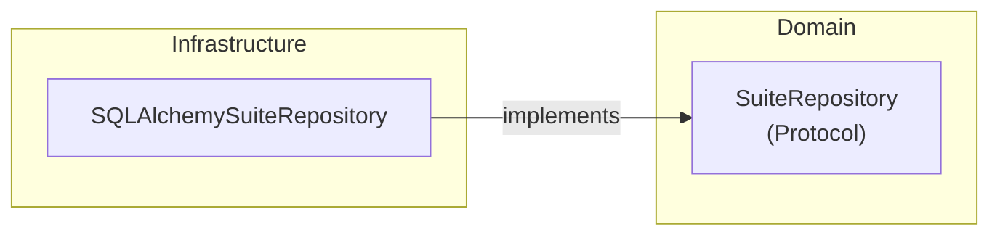

# 2. Domain independence

## What "independent" means

The **domain** is the part of the code that describes the problem: test suites,
test cases, expectations, runs, scores and the rule *"a test passes only if all its
expectations pass"*. These rules would stay the same if tomorrow we:

- replaced FastAPI with another web framework, or with a command-line interface;
- stored data in PostgreSQL or in files instead of SQLite;
- tested models from another provider instead of OpenAI.

A domain is **independent** when changes like these do not force us to touch it.
In practice: **domain code does not import frameworks, databases or web code.**

You can verify it yourself. These are the only external imports in the domain packages:

| Package | External libraries imported |
|---|---|
| `test_creation/` | none (only the standard library) |
| `reporting/` | none |
| `execution/eval_runner.py`, `eval_run.py`, `model.py`, `repository.py`, `exact_match_evaluator.py`, `mock_ai.py` | none |
| `execution/openai_model.py`, `llm_judge_evaluator.py`, `semantic_similarity_evaluator.py` | `openai` (only for its error type) |

The three OpenAI classes are **adapters**: their whole purpose is to talk to OpenAI,
so they are the edge of the domain (see [chapter 4](04-design-patterns.md#adapter)).
The important point is that the class that coordinates everything, `EvalRunner`,
does not know they exist: it only sees the `Model` and `Evaluator` interfaces.

These two interfaces are exactly the two points where an AI service enters the
application:

1. **The system under test (SUT)**: during a run, the runner asks a `Model` to answer
   each prompt.
2. **The AI evaluation service**: only `semanticSimilarity` and `llmJudge` expectations
   call an AI service through their `Evaluator`. `exactMatch` is a plain text comparison.

Because the domain sees only the interfaces, both points can be replaced by offline
**mocks** (`mock_ai.py`) without changing a single line of `EvalRunner`. Chapter 3 shows
how the mocks are switched on.

Nothing in the domain imports `fastapi`, `sqlalchemy` or `web_server`.

## Why it is worth it

1. **Easier to understand.** When you read `EvalRunner` you read only evaluation
   logic, with no HTTP status codes or SQL sessions in the way.
2. **Easier to test.** Domain classes can be tested with plain Python objects:
   no server to start, no real database, no paid API calls.
3. **Easier to change.** Each detail (web, database, AI provider) can be replaced
   without rewriting the rules of the problem.
4. **Reusable.** The same domain works with or without the web server.

## How the code achieves it

### Technique 1 — The domain declares interfaces for what it needs

The domain needs to save suites, but it must not know SQLite. So it declares
**what** it needs, as an interface, inside the domain itself:

```python
# test_creation/repository.py  (DOMAIN)
class SuiteRepository(Protocol):
    def save(self, suite: ITestSuite) -> None: ...
    def get(self, suite_id: UUID | str) -> ITestSuite | None: ...
    def list(self) -> list[ITestSuite]: ...
    def delete(self, suite_id: UUID | str) -> bool: ...
```

The **how** lives outside, in the infrastructure, which implements that interface:

```python
# persistence/sqlite.py  (INFRASTRUCTURE)
class SQLAlchemySuiteRepository(SuiteRepository):
    def __init__(self, engine: Engine):
        self.engine = engine

    def save(self, suite: ITestSuite) -> None:
        ...  # SQLAlchemy code
```

Notice the direction: `persistence` imports `test_creation`, never the opposite.
This is the **Dependency Inversion Principle** (the "D" of SOLID):

> High-level modules should not depend on low-level modules. Both should depend on
> abstractions.



The same happens for `RunRepository` (in `execution/repository.py`), for `Model` and
`ModelProvider` (in `execution/model.py`) and for `Evaluator`.

### Technique 2 — Translate at the border

The web server receives JSON and the database stores rows, but the domain works with
its own objects. The translation happens **at the border**, outside the domain:

| Border | From | To | Where |
|---|---|---|---|
| HTTP request in | JSON → Pydantic model (`TestSuiteInput`, …) | domain object (`TestSuite`, `Expectation`) | `web_server/app.py`, `helpers.py` |
| HTTP response out | domain object | dict → JSON | `suite_json`, `case_json`, … in `helpers.py` |
| Database write | domain object | `SuiteRow` / `RunRow` | `SQLAlchemySuiteRepository.save` |
| Database read | `SuiteRow` / `RunRow` | domain object | `_suite`, `_run` in `persistence/sqlite.py` |

The generated Pydantic models in `web_server/generated/` are **transport models**:
they describe the shape of the HTTP messages, not the domain. That is why the domain
has its own `TestSuite` class instead of reusing them.

### Technique 3 — Domain errors are plain Python errors

When data breaks a domain rule, the domain raises a normal `ValueError`:

```python
# test_creation/test_case.py
if not self.prompt or not self.prompt.strip():
    raise ValueError("Prompt must be set.")
```

The domain does not know about HTTP, so it cannot say "422". The web server
translates the error at the border:

```python
# web_server/helpers.py
try:
    return builder.build(id=id)
except ValueError as error:
    raise HTTPException(status_code=422, detail=str(error)) from error
```

### Technique 4 — The program can run without the web server

`composition.py` (next chapter) creates the domain objects **without importing
FastAPI**. A test checks this rule automatically:

```python
# tests/test_composition.py
subprocess.run([sys.executable, "-c", "import sys; import smartest_ai_testbook.composition; "
                "assert not any(m == 'fastapi' or m.startswith('fastapi.') for m in sys.modules); "
                "assert 'smartest_ai_testbook.web_server.app' not in sys.modules"], check=True)
```

The same test creates a suite, runs it and reads the result back **without any HTTP**.
If someone accidentally made the domain depend on the web server, this test would fail.

## Two levels of validation

A good example of the separation is validation. When a test case arrives over HTTP
it is checked twice, by two different layers with two different jobs:

| Layer | Checks | Example error |
|---|---|---|
| **Web server** (Pydantic models) | The *shape* of the message: required fields, types. | `title` is missing, `threshold` is not a number. |
| **Domain** (`TestCaseBuilder`, `validate_expectation`) | The *rules* of the problem. | Blank title, no expectations, exact match with threshold ≠ 1. |

The domain rules are checked even when the web server is not used, so they can never
be bypassed.

---

← [1. The big picture](01-architecture.md) · Next: [3. Dependency injection →](03-dependency-injection.md)
