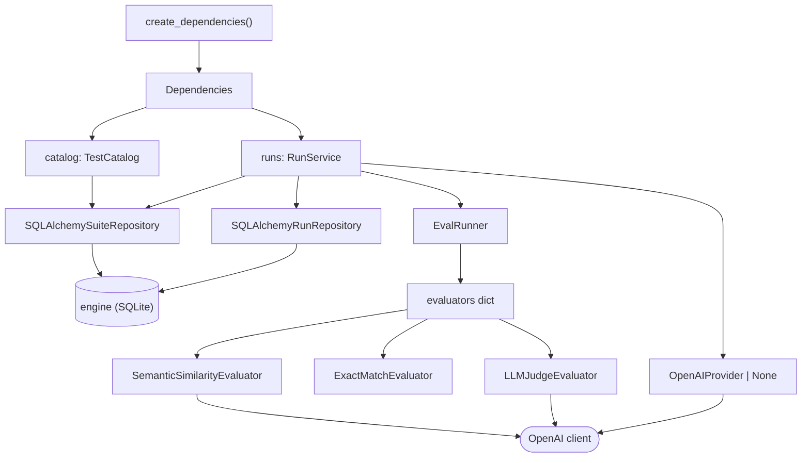

# 3. Dependency injection

## The problem

`EvalRunner` needs evaluators. The first idea is to create them inside the class:

```python
# What we do NOT do
class EvalRunner:
    def __init__(self):
        client = AsyncOpenAI()                       # needs an API key!
        self.evaluators = {
            "exactMatch": ExactMatchEvaluator(),
            "llmJudge": LLMJudgeEvaluator(client, "gpt-4o-mini"),
        }
```

This looks simple, but it causes problems:

- `EvalRunner` now depends on OpenAI: it cannot even be created without an API key.
- A test cannot replace the evaluators with fake ones, so every test calls a paid API.
- The model name `"gpt-4o-mini"` is hidden inside the class, so configuration is scattered.

## The solution: receive, do not create

With **dependency injection** an object **receives** its collaborators (its
*dependencies*) from outside, usually through the constructor:

```python
# execution/eval_runner.py — what the code actually does
class EvalRunner(IEvalRunner):
    def __init__(self, evaluators: Mapping[str, Evaluator]):
        self.evaluators = evaluators
```

`EvalRunner` does not know which evaluators exist or how they are built. It only
knows that each one respects the `Evaluator` interface. Whoever creates the runner
decides what to give it.

The same idea appears throughout the code:

| Class | Receives | Instead of creating |
|---|---|---|
| `EvalRunner` | a dict of `Evaluator`s | the evaluators |
| `EvalRunner.run(suite, model)` | the `Model` to test | an OpenAI client |
| `SQLAlchemySuiteRepository` | a database `engine` | its own database connection |
| `OpenAIModel`, `LLMJudgeEvaluator`, … | an OpenAI `client` | the client |
| `TestCatalog` | a `SuiteRepository` | its own database access |
| `RunService` | the two repositories, the runner and the provider | any of them |
| `create_app(dependencies)` | a `Dependencies` container with the two services | the services |

The application services show the point of the whole technique: `TestCatalog` saves
suites, but it only knows the `SuiteRepository` interface it received. It does not know
SQLite exists.

## The composition root

If nobody creates their own dependencies, **someone** must create them all. In this
project that someone is a single function, `create_dependencies` in
[`composition.py`](../src/smartest_ai_testbook/composition.py). The place where an
application assembles its objects is called the **composition root**.

```python
def create_dependencies(database_url=None, client=None, ai_mode=None, provider=None) -> Dependencies:
    # 1. Database
    engine = create_database(database_url or os.getenv("DATABASE_URL", "sqlite:///smartest-ai-testbook.db"))

    # 2. Evaluators: exactMatch is always available
    evaluators: dict[str, Evaluator] = {"exactMatch": ExactMatchEvaluator()}

    # 3. The two AI integration points: the SUT provider and the AI evaluators
    configured_provider = None
    if (ai_mode or os.getenv("AI_MODE")) == "mock":
        mock_evaluator = MockEvaluator()                  # offline, always scores 1
        evaluators.update({"semanticSimilarity": mock_evaluator, "llmJudge": mock_evaluator})
        configured_provider = MockProvider()              # offline SUT
    else:
        if client is None and os.getenv("OPENAI_API_KEY"):
            from openai import AsyncOpenAI
            client = AsyncOpenAI()
        if client is not None:
            evaluators.update({
                "semanticSimilarity": SemanticSimilarityEvaluator(client, ...),
                "llmJudge": LLMJudgeEvaluator(client, ...),
            })
            configured_provider = OpenAIProvider(client)

    # 4. Inject the collaborators into the two application services and return them
    suites = SQLAlchemySuiteRepository(engine)
    return Dependencies(
        catalog=TestCatalog(suites),
        runs=RunService(suites, SQLAlchemyRunRepository(engine), EvalRunner(evaluators),
                        provider if provider is not None else configured_provider),
    )
```

The result is a `Dependencies` object, a simple container (a `@dataclass`) holding the
two application services. Repositories, runner and provider are not in it: they are
injected into the services and stay hidden from the callers. The diagram shows the
OpenAI configuration:



Some things to notice:

- **Shared objects.** Both repositories receive the *same* `engine`; both services
  receive the *same* suite repository; the three OpenAI classes receive the *same*
  `client`. Only the composition root can arrange this, because only it sees all the objects.
- **Configuration in one place.** Environment variables (`DATABASE_URL`, `AI_MODE`,
  `OPENAI_API_KEY`, `OPENAI_EMBEDDING_MODEL`, `OPENAI_JUDGE_MODEL`) are read only here.
  Domain classes never read the environment.
- **Optional features.** Without an API key the application still starts: only
  `exactMatch` is available and the run service receives no provider. The service then
  rejects runs with a clear error, which the web server turns into a 422.
- **Typed by interface.** The fields of `Dependencies` use the service interfaces
  (`ITestCatalog`, `IRunService`), and the services' constructors use the repository and
  provider interfaces, never the SQLAlchemy or OpenAI classes. The code that uses
  `Dependencies` therefore does not depend on those details.

## Example: replacing the AI services with mocks

The application talks to an AI service at two points: the **system under test** (the
`provider` whose models answer the prompts) and the **AI evaluation service** (the
`semanticSimilarity` and `llmJudge` evaluators). Starting the backend with
`AI_MODE=mock` makes the composition root inject offline mocks at both points:

| Point | Default (OpenAI key set) | `AI_MODE=mock` |
|---|---|---|
| System under test | `OpenAIProvider` | `MockProvider`: answers `[mock] ` + the filled prompt |
| AI evaluation | `SemanticSimilarityEvaluator`, `LLMJudgeEvaluator` | `MockEvaluator`: score 1, feedback `Mock evaluation` |
| Exact match | `ExactMatchEvaluator` | `ExactMatchEvaluator` (unchanged) |

This is the clearest demonstration of dependency injection in the project: the
behavior of the whole application changes, yet `EvalRunner`, `RunService`, the routes and
the repositories are untouched. Only the composition root chooses different objects.
The mocks do not try to give realistic answers: they let you check the **flow** (create
a suite, run it, store and read the report) without credentials or costs.

## Who uses the composition root

The web server receives the dependencies through `create_app`:

```python
# web_server/app.py
def create_app(dependencies: Dependencies | None = None) -> FastAPI:
    app = FastAPI()
    app.state.dependencies = dependencies

    def deps():
        if app.state.dependencies is None:
            app.state.dependencies = create_dependencies()   # real objects, on first use
        return app.state.dependencies
```

- In **production**, nothing is passed: the real dependencies are created at the first
  request (so importing the module does not open the database).
- In **tests**, the test passes its own dependencies.

Every route then calls `deps().catalog` or `deps().runs` without knowing how they were
built. Code that does not use HTTP does the same:

```python
dependencies = create_dependencies()
suite = dependencies.catalog.create_suite("Capitals")
run = await dependencies.runs.run_suite(suite.id, "mock", "demo")
```

## The payoff: testing with fakes

Because everything is injected, tests can replace any real object with a **fake**: a
small class that respects the same interface but behaves in a predictable way.

```python
# tests/test_api_workflow.py
class Model:                                   # a fake Model: no network, always the same answer
    provider_name = "openai"
    model_name = "fake-model"

    async def generate_response(self, prompt, variables):
        return variables.get("city", "Paris")


class Provider:                                # a fake ModelProvider
    provider_name = "openai"

    def get_model(self, model_name):
        return Model()


def make_client(database_url):
    # a temporary test database + the fake provider, injected into the web app
    return TestClient(create_app(create_dependencies(database_url, provider=Provider())))
```

With one line the whole HTTP workflow is tested against a temporary database and a
fake model: no API key, no costs, same result every time. Tests can also simply ask for
the mocks: `create_dependencies(url, ai_mode="mock")`. Without dependency
injection this would be impossible without modifying the production classes.

## Summary

| Without dependency injection | With dependency injection |
|---|---|
| Each class creates what it needs. | Each class receives what it needs. |
| Configuration is scattered across the code. | Configuration is read in one place. |
| Classes depend on concrete implementations. | Classes depend on interfaces. |
| Tests need the real database and the real API. | Tests pass fakes. |

Dependency injection is what makes the domain independence of chapter 2 work in
practice: the domain declares interfaces, the composition root chooses the
implementations.

---

← [2. Domain independence](02-domain-independence.md) · Next: [4. Design patterns →](04-design-patterns.md)
