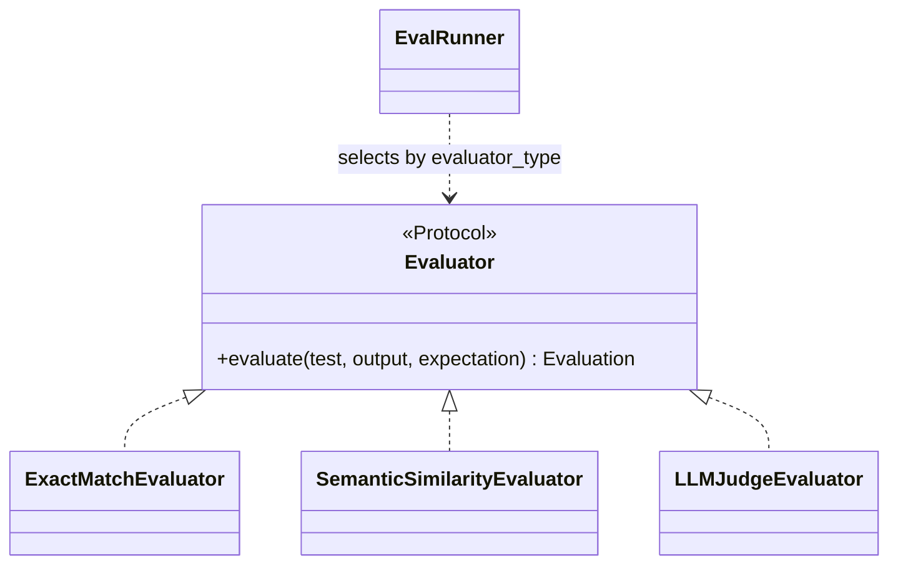
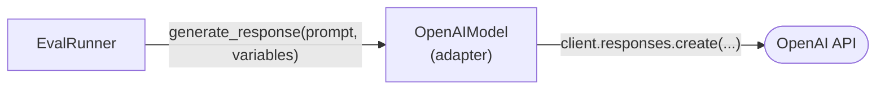
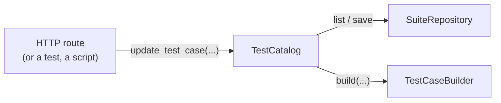

# 4. Design patterns

A **design pattern** is a well-known solution to a problem that appears again and
again in software design. Knowing the name of a pattern lets you recognise it quickly
and talk about the design with other developers.

For each pattern in this code we look at three things: the **problem**, the
**solution** and **where** to find it.

| Pattern | Problem it solves | Where |
|---|---|---|
| [Builder](#builder) | Create a valid test case step by step. | `TestCaseBuilder` |
| [Strategy](#strategy) | Choose the evaluation algorithm at run time. | `Evaluator` and its three implementations |
| [Adapter](#adapter) | Use the OpenAI API through our own `Model` interface. | `OpenAIModel` |
| [Repository](#repository) | Save and load domain objects without knowing the database. | `SuiteRepository`, `RunRepository` |
| [Application service](#application-service) | Give each use case one place, usable by any caller. | `TestCatalog`, `RunService` |
| [Composition root + DI](#composition-root-and-dependency-injection) | Create and connect all objects in one place. | `composition.py` |
| [Interfaces as contracts](#interfaces-as-contracts) | Let parts collaborate without knowing each other's classes. | every `Protocol` |

The first three are the patterns required by the
[domain design](../../doc/domain-design.md#3-required-patterns).

---

## Builder

**Problem.** A test case is valid only if it has a non-blank title, a non-blank prompt
and at least one valid expectation. With a plain constructor, an invalid object could
be created and used before anyone notices.

**Solution.** A separate *builder* object collects the parts one at a time and creates
the test case only at the end, in `build()`, after checking every rule. If something
is wrong, no test case is created at all.

```python
case = (TestCaseBuilder()
        .set_title("Capital of France")
        .set_prompt("What is the capital of France?")
        .add_expectation(Expectation("Exact", "exactMatch", 1, {"expected": "Paris"}))
        .build())          # validation happens here
```

Each `set_...` method returns `self`, so the calls can be chained (*fluent interface*).

```python
# test_creation/test_case.py (simplified)
def build(self, id: UUID | None = None) -> TestCase:
    if not self.title or not self.title.strip():
        raise ValueError("Title must be set.")
    if not self.prompt or not self.prompt.strip():
        raise ValueError("Prompt must be set.")
    if not self.expectations:
        raise ValueError("At least one expectation is required.")
    for expectation in self.expectations:
        validate_expectation(expectation)
    ...  # copy the data and return a new TestCase
```

`build()` also **copies** variables and expectations, so changing the builder later
does not change a test case that was already built.

**Where.** [`test_creation/test_case.py`](../src/smartest_ai_testbook/test_creation/test_case.py).
`TestCatalog` uses it every time it creates or changes a test case
([`test_creation/test_catalog.py`](../src/smartest_ai_testbook/test_creation/test_catalog.py)).

---

## Strategy

**Problem.** An expectation can be checked in three very different ways:

| Evaluator type | Algorithm |
|---|---|
| `exactMatch` | The answer must be identical to the expected text. |
| `semanticSimilarity` | The answer must have a similar *meaning* (embeddings and cosine similarity). |
| `llmJudge` | Another AI model judges the answer using a rubric. |

We do not want `EvalRunner` to be full of `if type == "exactMatch": ... elif ...`:
every new algorithm would mean changing the runner.

**Solution.** Each algorithm is a separate class (a *strategy*) that implements the same
interface. The runner only knows the interface and picks the right strategy by name.



```python
# execution/eval_runner.py (simplified)
score = await self.evaluators[expectation.evaluator_type].evaluate(test, output, expectation)
passed = score.value >= expectation.threshold
```

Every strategy returns the same kind of object, an `Evaluation` with a `value` from 0
to 1 and a `feedback` text. The strategy **measures**; the runner alone **decides**
pass/fail by comparing the value with the threshold. This keeps the rule in one place.

Adding a fourth algorithm means writing one new class and registering it in
`composition.py`. `EvalRunner` does not change.

The project already shows this with a fourth strategy: `MockEvaluator` (in
`execution/mock_ai.py`). It validates the expectation and always returns value 1 with
feedback `Mock evaluation`, without calling any AI service. In mock mode
(`AI_MODE=mock`) the composition root registers it under both `semanticSimilarity` and
`llmJudge`, and the runner uses it without knowing anything has changed.

**Where.** [`execution/exact_match_evaluator.py`](../src/smartest_ai_testbook/execution/exact_match_evaluator.py)
(which also defines the `Evaluator` interface and the `Evaluation` record),
[`semantic_similarity_evaluator.py`](../src/smartest_ai_testbook/execution/semantic_similarity_evaluator.py),
[`llm_judge_evaluator.py`](../src/smartest_ai_testbook/execution/llm_judge_evaluator.py).

---

## Adapter

**Problem.** The runner needs to ask a model for an answer. The OpenAI library has its
own API (`client.responses.create(model=..., input=...)`, a response object with
`status` and `output_text`, its own error types). If the runner used it directly, it
would be tied to OpenAI forever.

**Solution.** The domain defines the interface it wants:

```python
# execution/model.py
class Model(Protocol):
    provider_name: str
    model_name: str

    async def generate_response(self, prompt: str, variables: Mapping[str, str]) -> str: ...
```

An *adapter* class implements that interface by translating to the external API, like a
travel plug adapter between two different sockets:



`OpenAIModel.generate_response` does three translations:

1. it fills the `{{variable}}` placeholders of the prompt with the test variables;
2. it calls the OpenAI API;
3. it turns OpenAI errors and incomplete responses into ordinary Python errors.

The model being tested is called the **SUT** (*System Under Test*).

`ModelProvider.get_model(model_name)` returns the adapter for the model the user picked,
and `ModelProvider.provider_name` tells the web server which provider is configured.
`OpenAIProvider` is the OpenAI implementation; the fake `Provider` in the tests is
another one.

`MockProvider` and `MockModel` (in `execution/mock_ai.py`) are a third implementation,
used in mock mode instead of a real SUT. `MockModel` adapts the `Model` interface to
*nothing at all*: it answers `[mock] ` followed by the prompt with its variables filled
in. It reuses the same `fill_variables` function as `OpenAIModel`, so the mock shows
exactly the prompt the real model would receive.

The semantic similarity and LLM judge evaluators are also small adapters: they translate
the `Evaluator` interface into OpenAI embedding and response calls.

**Where.** [`execution/openai_model.py`](../src/smartest_ai_testbook/execution/openai_model.py)
and [`execution/mock_ai.py`](../src/smartest_ai_testbook/execution/mock_ai.py).

---

## Repository

**Problem.** Suites and runs must be saved in a database, but the domain and the routes
should not write SQL or know about tables.

**Solution.** A *repository* looks like a collection of objects (`save`, `get`, `list`,
`delete`) and hides how they are stored. The interface lives in the domain; the
implementation lives in the infrastructure (see the Dependency Inversion Principle in
[chapter 2](02-domain-independence.md#technique-1--the-domain-declares-interfaces-for-what-it-needs)).

```python
# test_creation/test_catalog.py: the service only sees the collection-like interface
suite = self.suites.get(suite_id)
suite.name, suite.description = name, description
self.suites.save(suite)
```

Inside, `SQLAlchemySuiteRepository` converts a `TestSuite` into a `SuiteRow` (the test
cases are stored as a JSON column) and back. Runs are stored in a separate table, so
editing a test later does not change results already recorded.

**Where.** Interfaces in [`test_creation/repository.py`](../src/smartest_ai_testbook/test_creation/repository.py)
and [`execution/repository.py`](../src/smartest_ai_testbook/execution/repository.py);
implementation in [`persistence/sqlite.py`](../src/smartest_ai_testbook/persistence/sqlite.py).

---

## Application service

**Problem.** A use case such as "update a test case" is a sequence: find the test inside
its suite, check that the new expectation IDs belong to it, rebuild it with the Builder,
put it back and save the suite. If this sequence lives in an HTTP route, any other caller
(a test, a script, a command-line tool) must repeat it, and the rules end up duplicated
or forgotten. Saving inside the entities (`suite.save()`, the *Active Record* pattern)
is no better: the entities would depend on the database.

**Solution.** An *application service* is a domain class with one operation per use case.
It receives the repositories (and, for runs, the runner and the provider) by dependency
injection, coordinates the entities and saves the result. Entities stay simple and
persistence-ignorant; routes become pure translation.



```python
# test_creation/test_catalog.py (simplified)
def update_test_case(self, case_id, title, prompt, variables, expectations):
    found = self._find_case(case_id)
    if found is None:
        return None                                     # the caller decides: 404, message, ...
    suite, index, old_case = found
    existing_ids = {item.id for item in old_case.expectations}   # a business rule, now in the domain
    input_ids = [item.id for item in expectations]
    if len(input_ids) != len(set(input_ids)) or not set(input_ids).issubset(existing_ids):
        raise ValueError("Expectation IDs must belong to this test case")
    case = _build_case(title, prompt, variables, expectations, id=old_case.id)   # the Builder validates
    suite.tests[index] = case
    self.suites.save(suite)                             # the Repository saves
    return case
```

Each service has a `Protocol` contract (`ITestCatalog`, `IRunService`). Outcomes stay
simple: `None` (or `False` for a delete) means "not found", `ValueError` means "invalid".

**Where.** [`test_creation/test_catalog.py`](../src/smartest_ai_testbook/test_creation/test_catalog.py)
and [`execution/run_service.py`](../src/smartest_ai_testbook/execution/run_service.py);
created in `composition.py`, used by `web_server/app.py` and `tests/test_composition.py`.

---

## Composition root and dependency injection

Covered in detail in [chapter 3](03-dependency-injection.md). In short: objects receive
their collaborators instead of creating them, and a single function,
`create_dependencies`, creates and connects everything.

---

## Interfaces as contracts

Not a pattern from a catalogue, but the foundation of all the others. Every domain class
explicitly implements a `Protocol` that describes its public contract:

| Contract | Implementation |
|---|---|
| `ITestCaseBuilder` | `TestCaseBuilder` |
| `ITestSuite` | `TestSuite` |
| `ITestCase` | `TestCase` |
| `IExpectation` | `Expectation` |
| `IEvalRunner` | `EvalRunner` |
| `IEvalRun` | `EvalRun` |
| `IEvalResult` | `EvalResult` |
| `IReportGenerator` | `ReportGenerator` |
| `IEvalReport` | `EvalReport` |
| `Evaluator` | `ExactMatchEvaluator`, `SemanticSimilarityEvaluator`, `LLMJudgeEvaluator`, `MockEvaluator` |
| `Model`, `ModelProvider` | `OpenAIModel`, `OpenAIProvider`, `MockModel`, `MockProvider` |
| `SuiteRepository`, `RunRepository` | `SQLAlchemySuiteRepository`, `SQLAlchemyRunRepository` |
| `ITestCatalog` | `TestCatalog` |
| `IRunService` | `RunService` |

Collaborators always refer to the contract, not to the class: for example,
`EvalRunner.run` accepts any `ITestSuite` and any `Model`. This is what lets the
patterns above work: a strategy, an adapter or a repository can be replaced because the
code that uses it only knows the contract.

### Plain records

Some types only carry data and have no behaviour. They are written as `@dataclass` and
are not domain classes with a contract:

- `Evaluation` — what an evaluator returns (`value`, `feedback`);
- `EvalScore` — the recorded outcome of one expectation;
- `ReportResult` — one row of a report;
- `Dependencies` — the container of the two application services, returned by the composition root.

---

← [3. Dependency injection](03-dependency-injection.md) · Next: [5. Order of execution →](05-execution-order.md)
