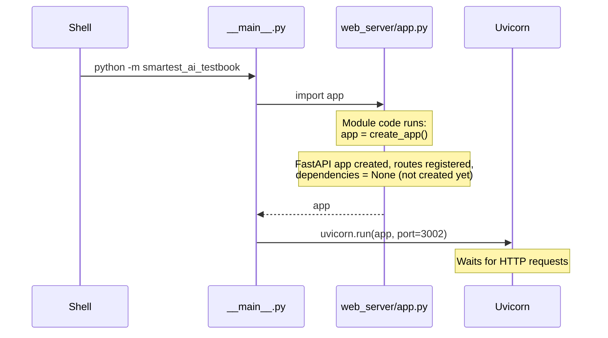
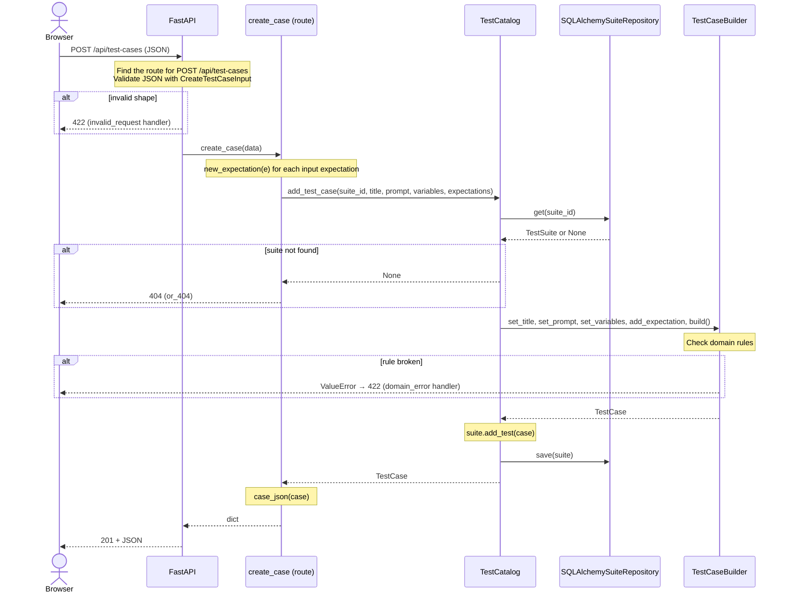
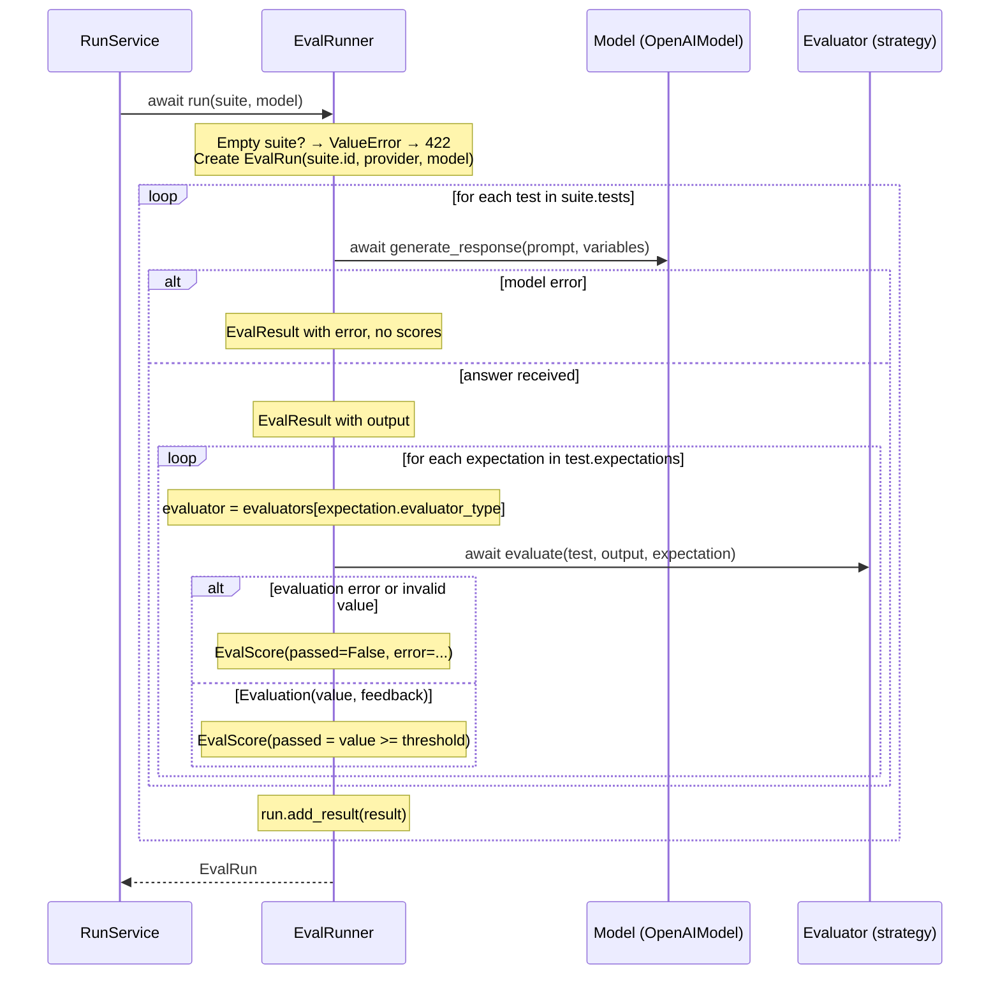
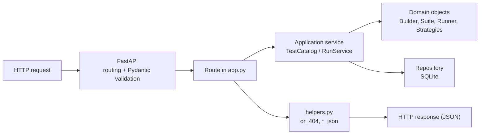

# 5. Order of execution

In this chapter we follow the program while it runs. We look at three moments:

1. **Startup**: from the command line to a server waiting for requests.
2. **A simple request**: creating a test case.
3. **The main use case**: running a suite and evaluating the answers.

## 1. Startup

The server is started with:

```sh
uv run python -m smartest_ai_testbook
```

`python -m package` runs the file `__main__.py` of that package. Here is what happens,
in order:



1. [`__main__.py`](../src/smartest_ai_testbook/__main__.py) imports `app` from `web_server/app.py`.
2. Importing a module runs its top-level code. The last line of `app.py` is
   `app = create_app()`.
3. `create_app` creates the FastAPI object, registers the error handler and the CORS
   middleware, and registers every route (each `@app.get`, `@app.post`, … decorator
   runs once now and records "for this method and path, call this function").
   The route functions themselves do **not** run yet.
4. `uvicorn.run` starts the HTTP server, which waits for requests.

Notice what has **not** happened yet: no database has been opened, no OpenAI client
created. `create_app` only stored `dependencies = None`.

### The first request: lazy creation of the dependencies

Every route calls `deps()`. The first time, `app.state.dependencies` is `None`, so
`deps()` calls `create_dependencies()` ([chapter 3](03-dependency-injection.md)):

1. `create_database(url)` creates the SQLAlchemy engine and the tables if they do not exist;
2. if `AI_MODE=mock`, the mock provider and mock evaluator are chosen; otherwise, if
   `OPENAI_API_KEY` is set, an OpenAI client is created;
3. the evaluators, the repositories, the runner and the provider are created and injected
   into the two application services, `TestCatalog` and `RunService`.

From the second request on, `deps()` returns the same objects.

## 2. A simple request: creating a test case

The browser sends:

```http
POST /api/test-cases
Content-Type: application/json

{"suite_id": "…", "title": "Capital", "prompt": "Capital of {{country}}?",
 "variables": {"country": "France"},
 "expectations": [{"name": "Exact", "evaluator_type": "exactMatch",
                   "threshold": 1, "options": {"expected": "Paris"}}]}
```



Step by step:

1. **Routing.** FastAPI finds the function registered with `@app.post("/api/test-cases")`.
2. **Shape validation.** The argument `data: CreateTestCaseInput` tells FastAPI to read
   the JSON body and validate it with that Pydantic model. If a field is missing or has
   the wrong type, the route is not even called: the client gets `422`.
3. **Transport → domain.** `new_expectation` turns each input expectation into a domain
   `Expectation`.
4. **Use case.** The route calls `catalog.add_test_case(...)`. From here on everything
   happens in the domain:
   - the catalog asks the repository for the suite; if it does not exist, it returns `None`;
   - it builds the test case with the **Builder**, which raises `ValueError` if a domain
     rule is broken;
   - it adds the test to the suite and **saves** the whole suite (test cases are stored
     inside their suite).
5. **Outcome → HTTP.** `None` becomes `404` through `or_404`; a `ValueError` becomes `422`
   through the `domain_error` handler; a test case becomes a dict through `case_json`,
   which FastAPI sends as JSON with status `201 Created`.

Every other route follows the same shape: *validate the shape → call one service
operation → translate the outcome*. Finding, building, checking rules and saving all
happen inside the service.

## 3. The main use case: running a suite

The browser sends `POST /api/test-suites/{suite_id}/eval-runs` with
`{"provider_name": "openai", "model_name": "gpt-4o-mini"}`.

### In the web server

```python
# web_server/app.py — create_run
run = await deps().runs.run_suite(suite_id, data.provider_name, data.model_name)
return run_json(or_404(run, "Suite not found"))
```

The route is `async def` because running a suite waits for the network many times.
While a route is waiting at an `await`, the server can serve other requests.

### In the domain: `RunService.run_suite`

```python
# execution/run_service.py
suite = self.suites.get(suite_id)
if suite is None:
    return None                                         # → 404
if self.provider is None or provider_name != self.provider.provider_name or not model_name.strip():
    raise ValueError("Unknown provider or unavailable model configuration")   # → 422
run = await self.runner.run(suite, self.provider.get_model(model_name))
self.runs.save(run)                                     # saved only when the run completes
return run
```

The service receives the configured provider (OpenAI, the mock, or `None` without an API
key) from the composition root, and accepts only runs for that provider.

### In the domain: `EvalRunner.run`

This is the heart of the application, in
[`execution/eval_runner.py`](../src/smartest_ai_testbook/execution/eval_runner.py).
It contains **two nested loops**: over the tests, and for each test over its expectations.



The rules applied by the runner:

1. **One answer per test.** The model is called once per test; every expectation
   evaluates that same answer.
2. **Errors stay local.** A model error fails only that test; an evaluator error fails
   only that expectation. The run always continues with the next test or expectation.
3. **The runner decides.** Evaluators return a value from 0 to 1; the runner checks it
   is a valid number and decides `passed = value >= threshold`.
4. **A test passes only if everything passes.** `EvalResult.passed` is a computed
   property, not a stored flag:

   ```python
   @property
   def passed(self) -> bool:
       return (self.error is None and self.output is not None
               and bool(self.scores) and all(score.passed for score in self.scores))
   ```

Tests and expectations run **in order, one at a time**: there is no parallelism, retry or
weighting. This keeps the behaviour simple to predict and explain.

### The two AI calls in the run

In the diagram above an AI service is called at two points only:

1. `Model.generate_response`: the **system under test** answers the prompt, once per test;
2. `Evaluator.evaluate`, but only for `semanticSimilarity` and `llmJudge` expectations:
   the **AI evaluation service** scores the answer. `exactMatch` compares texts locally.

In mock mode (`AI_MODE=mock`) both calls go to offline mocks. With the prompt
`Capital of {{country}}?`, the variable `country=France` and three expectations, the run
records:

| Step | Result |
|---|---|
| Mock model answer | `[mock] Capital of France?` |
| `exactMatch` expecting `Paris` | score 0, failed (real comparison) |
| `semanticSimilarity`, threshold 0.8 | score 1, passed, feedback `Mock evaluation` |
| `llmJudge`, threshold 0.8 | score 1, passed, feedback `Mock evaluation` |
| Test outcome | failed, because one expectation failed |

The sequence of calls is exactly the same as with real models: this is what the mocks
are for. They validate the flow, not the results.

### Back in the service and the web server

`RunService` saves the completed run in its own table (`self.runs.save(run)`) and returns
it; the route serialises it with `run_json(run)` and FastAPI answers `201 Created`. The browser shows each test, its output, the score
of every expectation and whether it passed.

### And the reporting subsystem?

`ReportGenerator.generate(run)` creates an `EvalReport`, an independent copy (snapshot) of
a finished run. Today it is used by the domain tests
(`tests/test_definitions_and_reporting.py`); the web server sends the stored run
directly with `run_json`.

## Summary of the whole journey



---

← [4. Design patterns](04-design-patterns.md) · Next: [6. How to read the code →](06-reading-guide.md)
