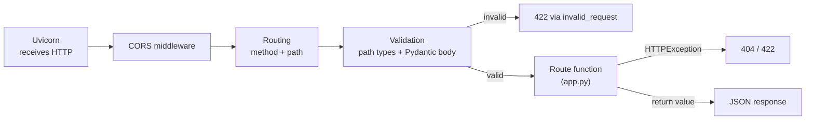

# Appendix A. FastAPI in this project

**FastAPI** is a Python framework for building HTTP APIs. You write normal Python
functions with type hints; FastAPI turns them into HTTP endpoints, reads and validates
the input, and converts the return value to JSON.

In this project FastAPI lives only in
[`web_server/`](../src/smartest_ai_testbook/web_server/): it is infrastructure, and the
domain never imports it ([chapter 2](02-domain-independence.md)).

## The pieces at a glance

| Piece | What it is | Where in the project |
|---|---|---|
| `FastAPI()` | The application object: holds routes, middleware and settings. | `create_app` in `app.py` |
| Route | A function bound to an HTTP method and a path. | every `@app.get/post/put/delete` in `app.py` |
| Pydantic model | A class describing the shape of a JSON body; used for validation. | `web_server/generated/models/` |
| `HTTPException` | An exception that becomes an HTTP error response. | `helpers.py`, `app.py` |
| Exception handler | A function that turns an exception type into a response. | `invalid_request` in `helpers.py` |
| Middleware | Code that runs around every request. | `CORSMiddleware` in `create_app` |
| Uvicorn | The server that receives HTTP connections and calls FastAPI. | `__main__.py` |
| `TestClient` | Sends requests to the app in tests, without a real server. | `tests/test_api_workflow.py` |

## 1. Application and server

```python
app = FastAPI()                       # web_server/app.py, inside create_app
...
uvicorn.run(app, host="0.0.0.0", port=3002)   # __main__.py
```

FastAPI does not listen on a network port by itself. **Uvicorn** (an ASGI server) accepts
connections and hands each request to `app`. The project builds the app inside a
function, `create_app(dependencies)`, so that tests can create apps with different
dependencies ([chapter 3](03-dependency-injection.md)).

## 2. Routes

A route is registered with a decorator naming the HTTP method and the path:

```python
@app.get("/api/test-suites")
def list_suites():
    return [suite_json(suite) for suite in deps().suites.list()]
```

| Decorator | HTTP method | Used for | Example |
|---|---|---|---|
| `@app.get` | GET | read | `GET /api/test-suites` |
| `@app.post` | POST | create | `POST /api/test-cases` |
| `@app.put` | PUT | replace / update | `PUT /api/expectations/{expectation_id}` |
| `@app.delete` | DELETE | delete | `DELETE /api/test-suites/{suite_id}` |

The decorator runs once, when `create_app` runs; the function runs at every matching request.

## 3. Where arguments come from

FastAPI looks at each parameter of the route function and decides where to read it:

```python
@app.put("/api/test-suites/{suite_id}")
def update_suite(suite_id: UUID, data: TestSuiteInput):
    ...
```

| Parameter | Source | Why |
|---|---|---|
| `suite_id: UUID` | the path | its name matches `{suite_id}` in the path |
| `data: TestSuiteInput` | the JSON body | its type is a Pydantic model |

The type hint is also a **check**: `suite_id` must be a valid UUID, and the body must
match `TestSuiteInput`. If not, FastAPI answers `422 Unprocessable Entity` and **the
function is never called**.

## 4. Pydantic models: validating the body

The input models are generated from the API contract `api/openapi.yaml`
([api-generation](../../doc/api-generation.md)). For example:

```python
# web_server/generated/models/test_suite_input.py (simplified)
class TestSuiteInput(BaseModel):
    name: Annotated[str, Field(min_length=1, strict=True)]   # required, not empty
    description: Optional[StrictStr] = None                  # optional
```

So `{"name": ""}` or `{"description": "x"}` (no name) are rejected with 422 before reaching
the route. Pydantic checks only the **shape** of the data; the domain still checks its own
**rules** (blank titles, thresholds, …) — see "Two levels of validation" in
[chapter 2](02-domain-independence.md#two-levels-of-validation).

These models are **transport models**: the route converts them into domain objects
(`TestSuite`, `Expectation`, …) and never passes them to the domain.

## 5. Responses and status codes

| What the route does | What the client receives |
|---|---|
| returns a `dict` or `list` | JSON, status 200 |
| has `status_code=201` in the decorator | JSON, status 201 Created |
| returns `Response(status_code=204)` | empty body, 204 No Content |
| returns a Pydantic model (`HealthResponse`) | the model as JSON |
| raises `HTTPException(status_code=404, detail="...")` | `{"detail": "..."}`, status 404 |

The project returns plain dicts built by the `*_json` helpers in `helpers.py`, which
choose the field names of the API contract.

Status codes used: **200** OK, **201** created, **204** deleted, **404** not found,
**422** invalid input (wrong shape, broken domain rule, or provider not configured).

## 6. Errors

Two mechanisms, both in the project:

```python
# 1. Raise an HTTPException anywhere during the request (route or helper)
raise HTTPException(status_code=404, detail="Suite not found")

# 2. Register a handler that turns an exception type into a response
app.add_exception_handler(RequestValidationError, invalid_request)
```

`RequestValidationError` is what FastAPI raises when Pydantic validation fails. The
project replaces the default handler only to keep the response valid JSON when the
input contains numbers such as `NaN` or `Infinity`.

Domain errors (`ValueError`) are not HTTP errors: helpers such as `build_case` catch them
and re-raise them as `HTTPException(422)`. This translation happens only in `web_server/`.

## 7. Middleware: CORS

```python
app.add_middleware(CORSMiddleware, allow_origins=["http://localhost:3000"],
                   allow_methods=["GET", "POST", "PUT", "DELETE"], allow_headers=["Content-Type"])
```

The browser blocks a page on `localhost:3000` from calling an API on `localhost:3002`
(a different *origin*) unless the API allows it. `CORSMiddleware` adds the headers that
grant this permission. The allowed origin comes from `WEB_ORIGIN`.

## 8. `def` or `async def`

| Route type | How FastAPI runs it | Used in the project for |
|---|---|---|
| `def` | in a thread pool, so blocking code does not stop the server | all CRUD routes (database access is synchronous) |
| `async def` | on the event loop; it can `await` | `create_run`, which awaits `EvalRunner.run` and the model calls |

Inside an `async def` route never call slow blocking code: it would freeze every other request.

## 9. Shared objects: `app.state` and `deps()`

FastAPI has its own dependency system (`Depends`), but the project does not need it.
Instead, the `Dependencies` container is stored in `app.state` and read through a small
closure:

```python
app.state.dependencies = dependencies       # may be None
def deps():
    if app.state.dependencies is None:
        app.state.dependencies = create_dependencies()   # created at the first request
    return app.state.dependencies
```

This keeps one composition root (`create_dependencies`) for the web server and for code
that does not use HTTP.

## 10. Free documentation

FastAPI generates an interactive API page at `http://localhost:3002/docs` from the routes
and models. It is useful to try the endpoints by hand. The official contract of the
project, however, is `api/openapi.yaml`.

## 11. Testing

```python
from fastapi.testclient import TestClient

with TestClient(create_app(dependencies)) as client:
    response = client.post("/api/test-suites", json={"name": "Suite"})
    assert response.status_code == 201
```

`TestClient` calls the app directly, without starting Uvicorn or opening a port. Combined
with injected dependencies (a temporary database, a fake or mock provider), the whole HTTP
workflow is tested in milliseconds.

## Summary: the life of a request



---

← [6. How to read the code](06-reading-guide.md) · Next: [Appendix B. SQLAlchemy →](08-sqlalchemy.md)
