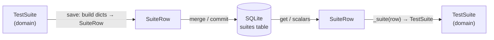

# Appendix B. SQLAlchemy in this project

**SQLAlchemy** is a Python library for working with relational databases. Its **ORM** (Object-Relational Mapper) lets you describe tables as Python classes and read or write rows as objects, without writing SQL by hand.

In this project SQLAlchemy lives only in [`persistence/sqlite.py`](../src/smartest_ai_testbook/persistence/sqlite.py), behind the repository interfaces of the domain ([chapter 2](02-domain-independence.md), [Repository pattern](04-design-patterns.md#repository)). 
The database is **SQLite**: a single file, no server to install.

## The pieces at a glance

| Piece | What it is | Where in the project |
|---|---|---|
| Engine | The connection factory for one database URL. | `create_database` |
| Declarative base | The parent class of all mapped tables. | `Base(DeclarativeBase)` |
| Mapped class (row) | A Python class that describes one table. | `SuiteRow`, `RunRow` |
| `Mapped[...]` / `mapped_column` | A column with its Python type and options. | the attributes of the rows |
| Session | A unit of work: tracks objects and talks to the database. | every repository method |
| Transaction | A group of changes saved all together or not at all. | `session.begin()` |
| `select` | Builds a query. | `list` methods |

## 1. Engine: the database connection

```python
engine = create_engine("sqlite:///smartest-ai-testbook.db")
```

The URL chooses the database (here a SQLite file; `DATABASE_URL` can change it). The engine is created **once**, in the composition root, and shared by both repositories ([chapter 3](03-dependency-injection.md)). It opens connections only when needed.

## 2. Tables as classes

```python
class Base(DeclarativeBase):
    pass


class SuiteRow(Base):
    __tablename__ = "suites"
    id: Mapped[str] = mapped_column(String, primary_key=True)
    name: Mapped[str] = mapped_column(String)
    description: Mapped[str] = mapped_column(String)
    tests: Mapped[list] = mapped_column(JSON)


class RunRow(Base):
    __tablename__ = "runs"
    id: Mapped[str] = mapped_column(String, primary_key=True)
    suite_id: Mapped[str] = mapped_column(ForeignKey("suites.id", ondelete="CASCADE"), index=True)
    started_at: Mapped[str] = mapped_column(String)
    provider_name: Mapped[str] = mapped_column(String)
    model_name: Mapped[str] = mapped_column(String)
    results: Mapped[list] = mapped_column(JSON)
```

| Code | Meaning |
|---|---|
| `__tablename__ = "suites"` | the table name in the database |
| `Mapped[str]` | the Python type of the attribute |
| `mapped_column(String, primary_key=True)` | the column type and options |
| `JSON` | the value is a list/dict stored as JSON text |
| `ForeignKey("suites.id", ondelete="CASCADE")` | each run belongs to a suite; deleting the suite deletes its runs |
| `index=True` | speeds up "all runs of this suite" queries |

### Why only two tables?

| Table | Contains | Design choice |
|---|---|---|
| `suites` | one row per suite; its test cases and expectations in the `tests` JSON column | a suite is always read and saved as a whole, so its parts do not need their own tables |
| `runs` | one row per run; its results and scores in the `results` JSON column | a run is a historical record; it is written once and read as a whole |

Keeping runs separate from suites means that editing or deleting a test does not change results already recorded. IDs are stored as strings because SQLite has no UUID type.

**Row classes are not domain classes.** `SuiteRow` is the shape of the data on disk; `TestSuite` is the domain object. The repository converts between them.

## 3. Creating the tables

```python
def create_database(database_url: str) -> Engine:
    engine = create_engine(database_url)

    @event.listens_for(engine, "connect")
    def enable_foreign_keys(connection, _record):
        cursor = connection.cursor()
        cursor.execute("PRAGMA foreign_keys=ON")
        cursor.close()

    Base.metadata.create_all(engine)
    return engine
```

- `Base.metadata.create_all(engine)` creates every table declared under `Base` **if it does not exist yet**. There is no migration tool: the tables are created on first use.
- SQLite ignores foreign keys unless each connection enables them. The `connect` event listener runs this command on every new connection, so `ondelete="CASCADE"` really works.

## 4. Sessions and transactions

All reads and writes go through a **session**:

```python
# Read: a session is enough
with Session(self.engine) as session:
    row = session.get(SuiteRow, str(suite_id))

# Write: a session plus a transaction
with Session(self.engine) as session, session.begin():
    session.merge(SuiteRow(...))
```

- `with Session(engine) as session:` opens a session and always closes it at the end of the block.
- `session.begin()` starts a transaction: at the end of the block it is **committed** if no exception occurred, or **rolled back** otherwise. A save is therefore all-or-nothing.
- Each repository method opens its own short session. No session is kept between requests.

## 5. The four operations of a repository

| Repository method | SQLAlchemy call | Effect |
|---|---|---|
| `save(suite)` | `session.merge(SuiteRow(...))` | insert the row, or update it if the primary key already exists |
| `get(suite_id)` | `session.get(SuiteRow, id)` | find a row by primary key, or `None` |
| `list()` | `session.scalars(select(SuiteRow))` | all rows as objects |
| `delete(suite_id)` | `session.get(...)` then `session.delete(row)` | remove the row (and, by cascade, its runs) |

Runs are filtered by suite with a `where` clause:

```python
select(RunRow).where(RunRow.suite_id == str(suite_id))
```

`select(...)` only builds the query; `session.scalars(...)` executes it and returns the
row objects.

## 6. Converting between rows and domain objects

The repository is a translator at the border of the domain:



- **Writing** (`save`): the domain object is turned into plain dicts and lists (the `tests` JSON), UUIDs into strings, then wrapped in a `SuiteRow`.
- **Reading** (`_suite`, `_run`): the row is turned back into domain objects
  (`TestSuite`, `TestCase`, `Expectation`, `EvalRun`, …), strings back into UUIDs.
  `_suite` also reads older definitions saved with shared criteria and moves them into the expectations, without rewriting the stored row.

The rest of the application never sees a `SuiteRow`: the application services call `self.suites.save(suite)` and `self.suites.get(id)` on the repository they received and get domain objects back. The routes do not touch repositories at all: they call the services.

## 7. Testing

Every test that needs a database passes its own URL to the composition root:

```python
url = f"sqlite:///{(tmp_path / 'application.db').as_posix()}"
dependencies = create_dependencies(url)
```

`tmp_path` is a temporary folder provided by pytest, so each test gets a fresh, empty database and the real `smartest-ai-testbook.db` is never touched. Creating a second `create_dependencies(url)` on the same file simulates a server restart and proves that the data was really saved.

## Summary

| Question | Answer in this project |
|---|---|
| Which database? | SQLite, one file, URL from `DATABASE_URL`. |
| How are tables defined? | Classes `SuiteRow` and `RunRow` with `Mapped` columns. |
| How are tables created? | `Base.metadata.create_all` at startup, if missing. |
| How is data saved? | A short session with a transaction; `merge` inserts or updates. |
| Where is SQLAlchemy used? | Only in `persistence/sqlite.py`. |
| Who sees it? | Nobody else: the application services only see `SuiteRepository` and `RunRepository`, and the routes only see the services. |

---

← [Appendix A. FastAPI](07-fastapi.md) · [Back to the lesson plan](README.md)
